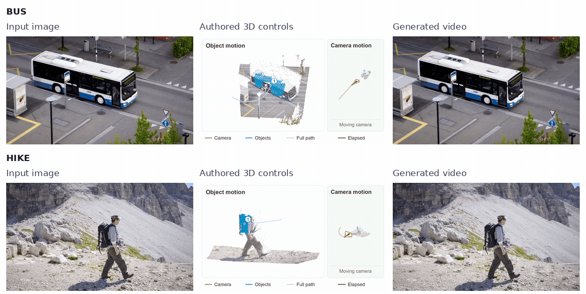
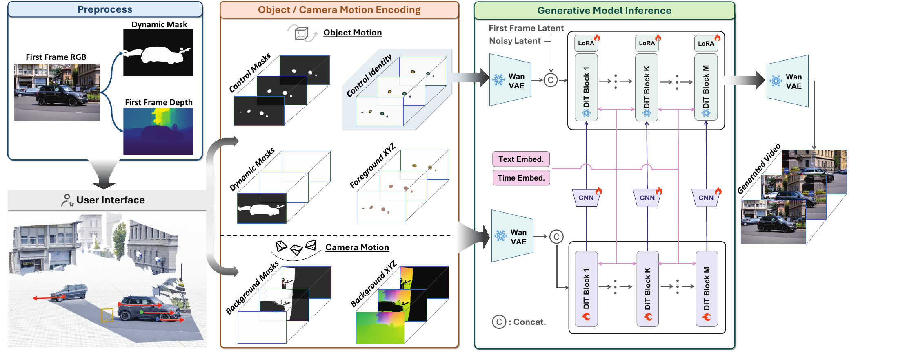

<h1 align="center">Generative Cinematographer</h1>
<h3 align="center">Composing Camera and Object Motion in 3D</h3>

<p align="center">
  <a href="https://vanillaer.github.io/">Jiahan Zhang</a> ·
  <a href="https://louiscroix.github.io/">Chaohao Yang</a> ·
  <a href="https://nam1410.github.io/">Namitha Guruprasad</a> ·
  <a href="https://github.com/vivekjyotibanerjee">Vivekjyoti Banerjee</a><br>
  <a href="https://nttung1110.github.io/">Trong-Tung Nguyen</a> ·
  <a href="https://www.cs.jhu.edu/~ayuille/">Alan Yuille</a> ·
  <a href="https://anandbhattad.github.io/">Anand Bhattad</a><br>
  Johns Hopkins University
</p>

<p align="center">
  <a href="https://generative-cinematographer.github.io/"></a>
  <a href="https://arxiv.org/abs/2610.02180"></a>
  <a href="https://huggingface.co/zonszer/Gencine_ckpts"></a>
</p>

**From a single image to a composed shot.** Author camera paths and object motion
together in 3D, then use a video diffusion model to generate the shot.

<p align="center">
  <a href="https://generative-cinematographer.github.io/#heroPreview">
    
  </a>
</p>

<p align="center">
  Input image → authored 3D controls → generated video.<br>
  <a href="https://generative-cinematographer.github.io/#overview">Watch the overview</a> ·
  <a href="https://generative-cinematographer.github.io/#heroPreview">Explore the interactive demos</a>
</p>

This repository provides **offline inference with preprocessed inputs**.
The included examples generate **21 frames at 832×480** using the provided
checkpoint. The demos above show authored motions from the project website;
the bundled examples use their provided trajectories.

[Environment](#environment) · [Download weights](#provided-checkpoint) ·
[Run inference](#run-inference) · [Examples](examples/README.md) · [Citation](#citation)

## Method overview

<p align="center">
  <a href="https://generative-cinematographer.github.io/#method">
    
  </a>
</p>

The full method lifts an image into a 3D scene, represents camera and object
motion with correspondence maps, and conditions video generation on those maps.
This release runs the inference stage using prepared image, text, and geometry
conditioning. See the [project website](https://generative-cinematographer.github.io/#method)
for the authoring workflow.

## Environment

| Component | Environment used for validation |
|---|---|
| OS | Linux x86-64 |
| Python | 3.11 |
| PyTorch | 2.8.0+cu128 |
| CUDA runtime | 12.8, supplied by the pinned Python packages |
| GPU | NVIDIA A100 80 GB |
| Precision / attention | BF16 / PyTorch SDPA |
| NVIDIA driver | 580.126.09 |

Allow about 50 GB of disk space for the checkpoint and enough host RAM to hold
the weights during loading and CPU/GPU transfers. `requirements.lock` pins the
runtime dependencies, including CUDA libraries and the video writer.

Clone the code repository, create an environment, and install the package:

```bash
git clone https://github.com/vanillaer/GenCine.git
cd GenCine
python3.11 -m venv .venv
source .venv/bin/activate
python -m pip install -r requirements.lock
python -m pip install --no-deps .
python -c "import torch; print(torch.__version__, torch.cuda.is_available())"
```

Reinstall with `python -m pip install --no-deps .` after changing package code.

## Provided checkpoint

The `--weights` argument points to the **bundle directory**, with this layout:

```text
weights/gencine/
├── model.json
├── dit.safetensors
├── vace.safetensors
├── scale3d.safetensors
└── vae_decoder.safetensors
```

The checkpoint repository is [Gencine_ckpts](https://huggingface.co/zonszer/Gencine_ckpts)
and is public. Install the Hugging Face CLI in your download environment
(`python -m pip install huggingface_hub`), then download the checkpoint:

```bash
hf download zonszer/Gencine_ckpts --revision 0c90925af792126ee26564fcdf840c09659ec18f \
  --local-dir weights/gencine
```

Pass the downloaded bundle directory to `--weights`. `model.json` contains the
model configuration and SHA-256 checksums for all four weight files. The loader
verifies these checksums and strictly loads all four model components.
No checkpoint download is performed during inference.

## Run inference

Run one example on GPU 0:

```bash
CUDA_VISIBLE_DEVICES=0 python -m gencine \
  --weights weights/gencine \
  --manifest examples/manifest.json \
  --example hike \
  --output outputs/hike_21
```

Run all provided examples sequentially, reusing the loaded models:

```bash
CUDA_VISIBLE_DEVICES=0 python -m gencine \
  --weights weights/gencine \
  --manifest examples/manifest.json \
  --all \
  --output outputs/examples_21
```

For available examples, see [example contents](examples/README.md) for their files and format.

| Setting | Default for the provided examples |
|---|---|
| Output frames | 21 |
| Resolution | 832×480 |
| Denoising steps | 50 |
| CFG / sigma shift / VACE scale | 3 / 5 / 1 |
| Noise | Saved seed-0 noise |
| Decode | Untiled |

The provided examples are prepared natively at 21 frames, with six latent frames
in the noise, identity, and geometry tensors. Frame count comes from each
example's metadata and encoded inputs. 

Use `--seed N` to regenerate noise, or omit it to reuse the saved noise.
Prompt text in metadata describes the cached embedding; editing the text alone
does not change model conditioning.

## Outputs

Each run saves:

- `video.mp4`: generated RGB video.
- `run.json`: effective settings, hashes, environment, timing, and peak GPU memory.
- `imported_modules.json`: imported package paths.

The provided examples use 3D annotations estimated with CoWTracker/ViPE.

The runtime contains model loading, denoising, and RGB decoding. New examples
need precomputed inputs; preprocessing and training are outside this package.
See `LICENSE` and `THIRD_PARTY_NOTICES.md` for licensing.

## Citation

If you use this project, please cite:

```bibtex
@misc{zhang2026generativecinematographer,
  title         = {Generative Cinematographer: Composing Camera and Object Motion in 3D},
  author        = {Zhang, Jiahan and Yang, Chaohao and Guruprasad, Namitha and Banerjee, Vivekjyoti
                   and Nguyen, Trong-Tung and Yuille, Alan and Bhattad, Anand},
  year          = {2026},
  eprint        = {2610.02180},
  archivePrefix = {arXiv}
}
```
